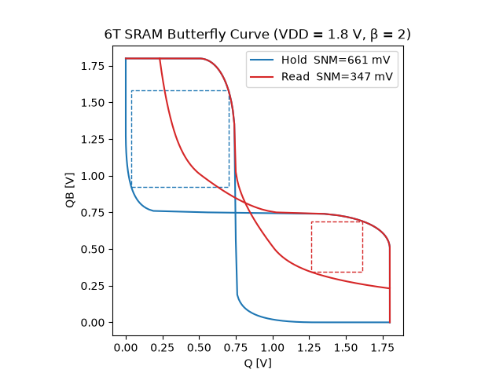
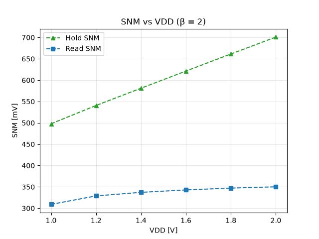
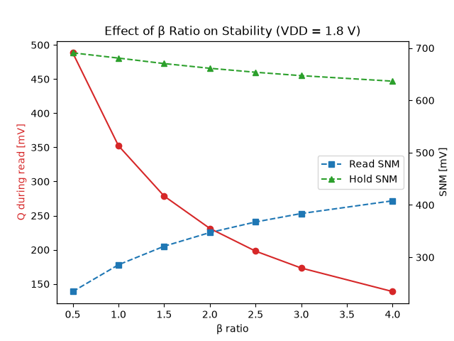
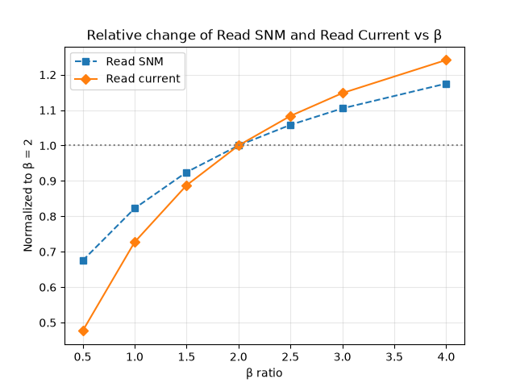
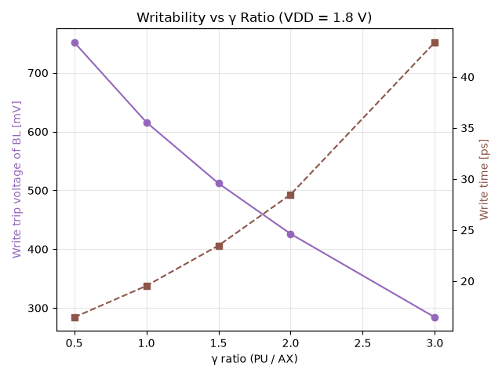

# 6T SRAM

ngspice(level-1 모델, 0.18 µm)로 6T SRAM 셀의 안정성(SNM)과 쓰기 특성을 분석하는 스크립트 모음.
기본 조건은 VDD = 1.8 V, W_AX = 0.36 µm.

## 구조

| 경로 | 설명 |
|---|---|
| `sim.py` | 넷리스트 템플릿의 키워드(`VDD_VALUE`, `WPD` 등)를 치환해 ngspice를 batch 실행 |
| `curve_sum.py` | VTC 한 개로 SNM 계산 (45° 회전 후 가장 큰 내접 정사각형, 대칭 셀 가정) |
| `curve.py` | Hold/Read butterfly curve와 SNM |
| `vdd_sweep_loop.py` | VDD 스윕 (β = 2) |
| `beta_sweep_loop.py` | β ratio 스윕 (VDD = 1.8 V) |
| `write_sweep_loop.py` | γ ratio 스윕 (쓰기 trip 전압, 쓰기 시간) |
| `circuit/` | 넷리스트. `*_template.cir`는 스크립트가 값을 채워 넣는 템플릿 |
| `data/`, `Fig/` | 시뮬레이션 결과 / 그래프 |

실행: `python curve.py`, `python vdd_sweep_loop.py` 등 (ngspice, numpy, matplotlib 필요).

## 사용한 비율

- β = W_PD / W_AX (pull-down / access)
- γ = W_PU / W_AX (pull-up / access)

## 코드 설명

- **SNM 계산**: half-cell(인버터 + access TR)의 VTC를 DC 스윕으로 구한다. 셀이 대칭이라고 가정하고 같은 곡선을 x=y에 대해 뒤집어 butterfly를 만든다. 두 곡선의 차이를 45° 회전한 좌표에서 구해, 두 눈 중 작은 쪽의 정사각형 한 변을 SNM으로 한다.
- **Hold / Read**: WL=0이면 Hold, WL=VDD(BL=VDD)이면 Read. `half_cell.cir`에서 `alter vwl dc=0`으로 한 번에 둘 다 뽑는다.
- **쓰기 trip 전압** (`wr_template.cir`): BL을 VDD → 0 V로 내리며 Q가 VDD/2 아래로 처음 떨어지는 BL 전압.
- **쓰기 시간** (`wt_template.cir`): transient에서 WL이 VDD/2를 넘는 시점부터 Q가 VDD/2 아래로 내려갈 때까지의 시간. 확산 영역 면적/둘레(`AD/AS/PD/PS`)를 넣어 접합 커패시턴스를 반영했다.

## 그래프

**`butterfly_curve_snm.png`**

Hold SNM 661 mV, Read SNM 347 mV. Read에서는 access TR 때문에 '0' 쪽 레벨이 올라가 눈이 작아진다.

**`vdd_sweep_2.png`**

VDD가 커질수록 SNM이 증가한다. Hold SNM은 VDD에 거의 비례해서 늘고, Read SNM은 완만하게 늘어 둘의 차이가 벌어진다.

**`beta_sweep.png`**

β가 커질수록 Read 중 Q 전압이 내려가고(빨강, 485 → 140 mV) Read SNM이 올라간다(파랑). Hold SNM은 거의 변하지 않고 약간 줄어든다.

**`beta_iread.png`**

β = 2를 1로 정규화한 Read SNM과 Read current. β를 키우면 둘 다 증가한다. β가 작은 구간에서 Read current가 더 가파르게 변한다.

**`write_sweep.png`**

γ가 커질수록(pull-up이 강해질수록) 쓰기가 어려워진다. trip 전압은 750 → 285 mV로 낮아지고, 쓰기 시간은 길어진다. 안정성(β)과 쓰기 용이성(γ) 사이에 trade-off가 있다.
